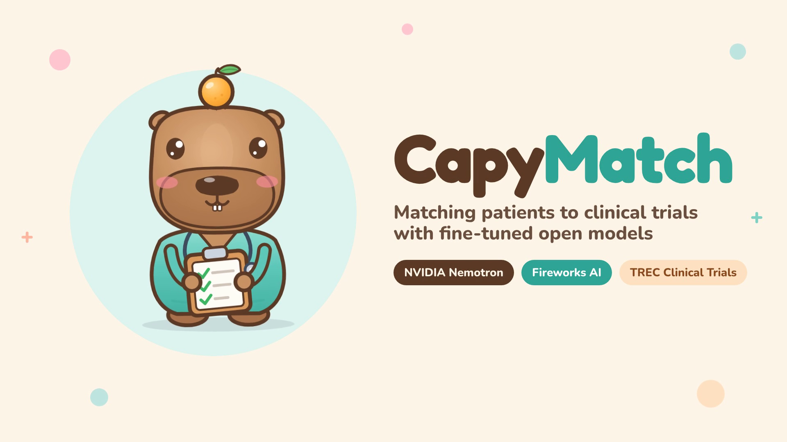
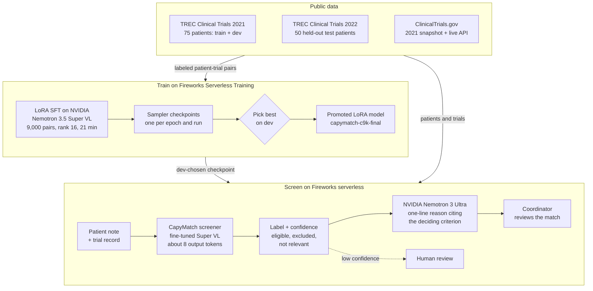
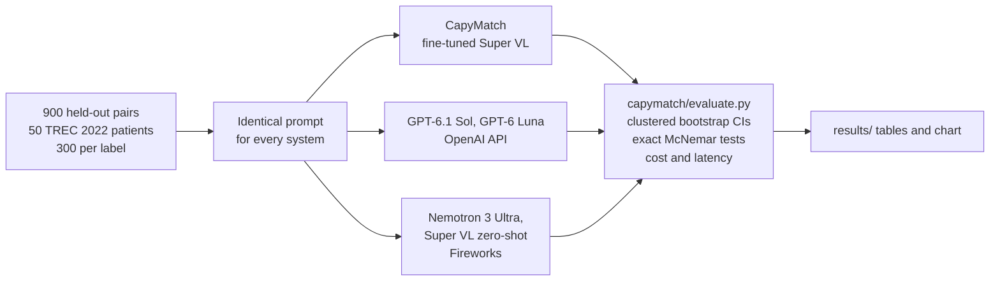

<p align="center"></p>

# CapyMatch

CapyMatch pre-screens patients for clinical trials. Given a patient note and a ClinicalTrials.gov record, it decides
whether the patient is **eligible**, **excluded**, or **not relevant**, and explains the criterion that decided it. We
fine-tuned **NVIDIA Nemotron 3.5 Super VL** with LoRA on 9,000 expert-judged patient–trial pairs using **Fireworks
serverless training**, and run **NVIDIA Nemotron 3 Ultra on Fireworks** to write a one-line reason for the
coordinator. On 900 held-out pairs from 50 patients the model never saw, CapyMatch is the most accurate system we tested:
**74.1%**. That is statistically tied with OpenAI's flagship GPT-6.1 Sol (72.1%) at **about a quarter of the cost**, and
significantly ahead of GPT-6 Luna, Nemotron 3 Ultra, and its own zero-shot base.

<p align="center">
  <a href="video/capymatch_demo.mp4"></a><br>
  <b><a href="video/capymatch_demo.mp4">▶ Watch the 87-second demo</a></b> ·
  <a href="SUBMISSION.md">Submission notes</a> · <a href="#try-it">Try it</a> · <a href="#reproduce">Reproduce</a>
</p>

## The problem

- **Most clinical trials miss their enrollment targets**, and finding eligible patients is one of the main reasons.
- **Matching is manual.** A research coordinator reads each patient's chart against each candidate trial's eligibility
  criteria. That can mean dozens of inclusion and exclusion rules per trial, across hundreds of open trials.
- **LLMs can read criteria, but the economics and the data don't fit.** Frontier pricing multiplies with patients ×
  trials, and many hospitals can't send patient records to a closed API. Screening needs a model that is accurate,
  cheap per check, and deployable where the data lives.

## Our solution

- **A specialized screener.** We LoRA fine-tuned NVIDIA Nemotron 3.5 Super VL on expert judgments from the TREC Clinical
  Trials benchmark. Super VL is an open-weights mixture-of-experts model with 120B parameters, 12B active per token.
  Each check reads the patient note and trial record and emits a single label, about 8 output tokens. A confidence score
  comes from the label token's probability.
- **Explanations a coordinator can verify.** NVIDIA Nemotron 3 Ultra turns each call into one sentence that cites the
  deciding criterion, for example *"Patient is 47, below the trial's minimum age of 60."*
- **Selective screening.** Confidence lets a site auto-screen most pairs and route the rest to people. On its 70%
  most-confident pairs, CapyMatch is 82.1% accurate.
- **Runs today:** a CLI that screens a patient against live ClinicalTrials.gov records, a demo page, and a promoted LoRA
  model ready for a Fireworks deployment.

## Results at a glance

On **900 held-out patient–trial pairs from 50 new patients** (TREC Clinical Trials 2022, 300 per label), with 95%
confidence intervals from a patient-clustered bootstrap:

<p align="center"></p>

| System | Accuracy (95% CI) | Eligible precision / recall | $ per 1,000 screenings |
|---|---|---|---|
| **CapyMatch: Nemotron 3.5 Super VL + LoRA (ours)** | **74.1%** (70.8–77.4) | 72% / **79%** | **$0.47** |
| GPT-6.1 Sol (OpenAI flagship) | 72.1% (68.1–75.6) | 79% / 72% | $1.80 |
| GPT-6 Luna (OpenAI low-cost tier) | 70.8% (66.5–74.5) | 82% / 69% | $0.13 |
| Nemotron 3.5 Super VL, zero-shot | 69.3% (65.7–72.7) | 83% / 58% | $0.47 |
| Nemotron 3 Ultra, zero-shot | 68.4% (64.5–72.2) | 81% / 65% | $1.78 |

- **Frontier parity at about a quarter of the cost.** CapyMatch is +2.0 pts ahead of GPT-6.1 Sol (95% CI −1.0 to +5.2,
  McNemar p = 0.19). That is not a significant difference, so we claim parity, at 3.8× lower cost.
- **Significantly better than the other baselines:** +3.3 pts vs GPT-6 Luna (p = 0.022) and +5.7 pts vs Nemotron 3 Ultra
  (p < 0.001).
- **Fine-tuning is the lever:** +4.8 pts over the same model zero-shot (95% CI +2.9 to +6.7, p < 0.001).
- **Finds the most eligible patients:** 79% recall on `eligible`, the highest of any system, at lower precision. That is
  the right tradeoff for pre-screening, where a coordinator confirms every flagged match.

Full tables (macro-F1, paired differences, latency, selective screening, and the 3k-pair ablation) are in
[Detailed results](#detailed-results).

## Sponsors used

| Sponsor | What we used | Role in CapyMatch | Code |
|---|---|---|---|
| **Fireworks AI** | Serverless Training: LoRA SFT with the Training SDK (`fireworks-ai[training]`) | Fine-tuned the screener in two runs (3k and 9k pairs), about 20 minutes each, with no GPUs to provision | [`finetune.py`](capymatch/finetune.py) |
| | Serverless sampling (training pool) | Scored the base model and every checkpoint on dev and test without a deployment; token log-probs give the confidence score | [`run_sampler.py`](capymatch/run_sampler.py) |
| | Serverless inference (OpenAI-compatible chat completions) | Runs Nemotron 3 Ultra for the coordinator explanations, and as a zero-shot baseline | [`explain.py`](capymatch/explain.py), [`run_chat.py`](capymatch/run_chat.py) |
| | Checkpoint promotion | Saved the chosen LoRA as a deployable Fireworks model, `capymatch-c9k-final` | [`finetune.py`](capymatch/finetune.py) |
| **NVIDIA** | Nemotron 3.5 Super VL 120B-A12B (BF16) | The model we fine-tuned, which is CapyMatch itself | [`nemotron.py`](capymatch/nemotron.py) |
| | Nemotron 3 Ultra 550B-A55B (NVFP4) | Writes the one-line, criterion-citing explanation; also a zero-shot baseline | [`explain.py`](capymatch/explain.py) |

Not sponsors, listed for transparency: OpenAI GPT-6.1 Sol and GPT-6 Luna (baselines only), ElevenLabs (video
narration), and public data from TREC (NIST) and ClinicalTrials.gov (U.S. National Library of Medicine).

## Fireworks AI

Everything CapyMatch trains, evaluates, and serves runs on Fireworks. We never provisioned a GPU.

### Serverless Training: LoRA fine-tuning

- **Our own training loop on the Fireworks Training SDK** ([`capymatch/finetune.py`](capymatch/finetune.py)):
  1. `FiretitanServiceClient` connects to `/training/v1/serverless`.
  2. `create_lora_training_client(rank=16)` opens a LoRA run.
  3. Each step calls `forward_backward(batch, "cross_entropy")` and `optim_step(AdamParams)`.
  4. `save_weights_for_sampler()` saves a checkpoint after each epoch.
- **Loss on the decision only.** Prompts use Nemotron's official chat template with thinking disabled. Loss weights are 1
  only on the answer tokens (`{"label": ...}<|im_end|>`), so the model learns the decision, not the prompt.
- **Hyperparameters:** batch 32, Adam (β1 0.9, β2 0.95), peak LR 1e-4 with a 6-step warmup and cosine decay. Per-step
  loss is logged to `results/train_log_*.jsonl`.

| Run | Training pairs | Epochs | Steps | Training tokens | Wall time | Dev accuracy |
|---|---|---|---|---|---|---|
| `capy` | 3,000 | 2 | 188 | 5.4M | 19 min | 77.5% (epoch 1), 75.8% (epoch 2) |
| **`c9k` (CapyMatch)** | 9,000 | 1 | 282 | 8.3M | 21 min | **79.2%** |

### Serverless sampling for evaluation

- **Scoring without a deployment** ([`capymatch/run_sampler.py`](capymatch/run_sampler.py)):
  - `create_sampling_client(base_model=...)` scores the zero-shot base model.
  - `create_sampling_client(model_path=<checkpoint>)` scores each fine-tuned checkpoint.
  - Both use greedy decoding and stop on `<|im_end|>`.
  - Checkpoints could be sampled from a separate process after training finished.
- **Confidence comes free.** The sampler returns per-token log-probabilities, and the probability of the label's first
  token is CapyMatch's confidence score. That score drives selective screening.
- **Clean selection.** Checkpoints were chosen on the dev split only, and each reported model was scored on test once.

### Serverless inference

- Nemotron 3 Ultra runs on Fireworks' OpenAI-compatible chat completions endpoint, both as a zero-shot baseline (900
  test pairs) and as the explanation writer ([`capymatch/explain.py`](capymatch/explain.py)).
- The runner records token usage, client latency, and the `fireworks-server-processing-time` header for every call
  ([`capymatch/run_chat.py`](capymatch/run_chat.py)).

### From checkpoint to deployment

`promote_session_checkpoint` turned the dev-chosen checkpoint into a deployable LoRA model, `capymatch-c9k-final`. A
site would serve it with `firectl deployment create <model> --deployment-shape default`, which merges the adapter into
the base weights at deployment time.

### Cost on Fireworks

- **Both fine-tuning runs:** about **$32** (an estimate: 13.7M training tokens at $2.32 per 1M).
- **Screening with the fine-tuned model:** **$0.47 per 1,000 patient–trial checks** at serverless-training sampling rates.
- **Everything else on Fireworks** (zero-shot baselines, explanations, dev evaluations): about $3.

## NVIDIA

Both models in the CapyMatch pipeline are NVIDIA Nemotron models.

### Nemotron 3.5 Super VL 120B-A12B: the fine-tuned screener

- **Why this model.** It has open weights and a mixture-of-experts design with only 12B of its 120B parameters active per
  token. It also takes images, which leaves room for scanned referral letters and lab reports later. Open weights matter
  here: a hospital can run the same tuned model inside its own environment instead of sending patient records to a
  closed API.
- **How we tuned it.** We trained rank-16 LoRA adapters on 12 projection types across the network (`q_proj`, `k_proj`,
  `v_proj`, `o_proj`, `in_proj`, `out_proj`, `up_proj`, `down_proj`, `w1`, `w2`, `fc1_latent_proj`,
  `fc2_latent_proj`, per the promoted model's metadata). Training and serving use Nemotron's thinking-off mode, so each
  screening is a direct label of about 8 tokens rather than a reasoning trace.
- **What fine-tuning bought.** Zero-shot, Super VL scores 69.3%, below GPT-6 Luna. After LoRA on 9,000 pairs it scores
  **74.1% (+4.8 pts, p < 0.001)**, the best of any system tested. It also beats Nemotron 3 Ultra, a model with more than
  4× the total parameters, by 5.7 pts.
- **Data scaling.** Tripling the training data from 3,000 to 9,000 pairs added +1.0 pt on test (not significant) and +1.7
  pts on dev, so most of the gain comes from the first few thousand examples.

### Nemotron 3 Ultra 550B-A55B (NVFP4): explanations and baseline

- **Explanations.** Ultra reads the patient, the trial, and CapyMatch's label, and writes one sentence citing the deciding
  criterion, for example *"Excluded because the patient has cataract indicated by loss of red reflex."* It runs with
  reasoning on, because explanation quality matters more than speed here. In production it only needs to run on the
  matches a coordinator actually reviews.
- **Baseline.** Zero-shot, Ultra scores 68.4% and emits about 540 output tokens per screening, mostly reasoning. The
  fine-tuned Super VL emits about 8. The smaller fine-tuned model is both more accurate and far cheaper to run.

## Architecture



How every system was scored on the same footing:



## Detailed results

All systems were scored on the same 900 test pairs. Δ is CapyMatch minus the baseline, and p comes from an exact McNemar
test. These tables are generated by `make evaluate` (source: [`results/results.md`](results/results.md)).

| System | Type | Accuracy (95% CI) | Macro-F1 (95% CI) | Eligible P / R | $ per 1k screens | p50 latency |
|---|---|---|---|---|---|---|
| **CapyMatch (Super VL + LoRA, ours)** | open + fine-tuned on Fireworks | **74.1%** (70.8–77.4) | 73.9 (70.6–77.2) | 72% / 79% | $0.47 | 4.5s |
| CapyMatch, 3k-pair LoRA (ablation) | open + fine-tuned on Fireworks | 73.1% (69.3–76.8) | 72.8 (68.8–76.5) | 72% / 78% | $0.47 | 3.7s |
| GPT-6.1 Sol | closed frontier (OpenAI) | 72.1% (68.1–75.6) | 71.7 (67.7–75.2) | 79% / 72% | $1.80 | 1.4s |
| GPT-6 Luna | closed, low-cost tier (OpenAI) | 70.8% (66.5–74.5) | 70.3 (65.8–74.1) | 82% / 69% | $0.13 | 1.6s |
| Nemotron 3.5 Super VL, zero-shot | open, Fireworks serverless sampling | 69.3% (65.7–72.7) | 69.5 (65.8–72.9) | 83% / 58% | $0.47 | 0.9s |
| Nemotron 3 Ultra, zero-shot | open, Fireworks serverless | 68.4% (64.5–72.2) | 67.7 (63.6–71.5) | 81% / 65% | $1.78 | 4.0s |

| Ours vs | Accuracy Δ (95% CI) | Macro-F1 Δ (95% CI) | McNemar p | Cost ratio (baseline ÷ ours) |
|---|---|---|---|---|
| GPT-6.1 Sol | +2.0 pts (-1.0 to +5.2) | +2.1 (-0.9 to +5.5) | 0.19 | 3.8× |
| GPT-6 Luna | +3.3 pts (+0.7 to +6.5) | +3.6 (+0.8 to +6.9) | 0.022 | 0.3× |
| Nemotron 3 Ultra, zero-shot | +5.7 pts (+2.7 to +8.8) | +6.2 (+3.0 to +9.4) | 0.00014 | 3.8× |
| Nemotron 3.5 Super VL, zero-shot | +4.8 pts (+2.9 to +6.7) | +4.4 (+2.3 to +6.4) | 0.00075 | 1.0× |
| CapyMatch, 3k-pair LoRA (ablation) | +1.0 pts (-0.2 to +2.2) | +1.1 (-0.2 to +2.4) | 0.22 | 1.0× |

**Selective screening** (CapyMatch auto-screens confident pairs; the rest go to GPT-6.1 Sol):

| Auto-screened share | CapyMatch accuracy on auto-screened | Overall accuracy with escalation | $ per 1k screens |
|---|---|---|---|
| 100% | 74.1% | 74.1% | $0.47 |
| 90% | 77.2% | 73.6% | $0.65 |
| 80% | 79.2% | 73.3% | $0.83 |
| 70% | 82.1% | 73.4% | $1.01 |
| 60% | 83.9% | 72.2% | $1.19 |
| 50% | 87.1% | 72.4% | $1.37 |

With the confidence threshold fixed on dev (keep 80% of dev pairs): 73% of test pairs auto-screened at 81.2% accuracy; overall 73.8% (95% CI 69.9–77.4), +1.7 pts vs GPT-6.1 Sol alone (95% CI +0.0 to +3.3, McNemar p=0.063) at $0.96 per 1k screens.

**Tradeoffs we measured:**
- **GPT-6 Luna is cheaper** per screening ($0.13 vs $0.47), but 3.3 pts less accurate (p = 0.022).
- **Eligible precision is lower** than the OpenAI models' (72% vs 79% for GPT-6.1 Sol). CapyMatch errs toward flagging
  possible matches.
- **Latency was measured on Fireworks' shared training pool** (p50 4.5 s), not on a production deployment. A dedicated
  deployment serves the merged model at base-model speed; the base model's p50 was 0.9 s on the same pool.
- **Escalating to GPT-6.1 Sol barely helps.** Sending CapyMatch's least-confident pairs to Sol leaves overall accuracy
  about the same, because Sol struggles on the same hard pairs. Confidence is better used to route work to a human.

## How we evaluated

- **Data:** [TREC Clinical Trials](https://www.trec-cds.org/) 2021 and 2022. These are synthetic patient descriptions
  written by clinicians, real ClinicalTrials.gov records (2021-04-27 snapshot), and expert judgments
  (2 = eligible, 1 = excluded, 0 = not relevant).
- **Splits (no patient appears in more than one):**
  - train: 9,000 pairs from 70 TREC 2021 patients (the first run used a 3,000-pair subset)
  - dev: 120 pairs from 5 other 2021 patients
  - **test: 900 pairs from all 50 TREC 2022 patients**, label-balanced (300 per class), spread round-robin across patients
- **Same input for everyone:** every system, ours and the baselines, gets the identical system prompt and input
  ([`capymatch/prompts.py`](capymatch/prompts.py)). OpenAI models run with their default reasoning settings.
- **Metrics:** accuracy, macro-F1, and precision/recall on `eligible`; cost per 1,000 screenings at list price from
  measured tokens; client-side latency.
- **Uncertainty:** 95% confidence intervals come from a **patient-clustered bootstrap** (2,000 draws over the 50 test
  patients), because pairs from one patient are correlated. Paired differences use the same draws. Significance comes
  from **exact McNemar tests** on per-pair correctness.
- **Checkpoint selection:** done on dev, never on test. Dev accuracy was 77.5% (`capy` epoch 1), 75.8% (`capy` epoch 2),
  and 79.2% (`c9k`). Full disclosure: we trained `c9k` after seeing the first model's test score. The choice between them
  used dev only, and both test scores are reported.

## Try it

Screen a patient against live ClinicalTrials.gov records with the fine-tuned model:

```bash
.venv/bin/python -m capymatch.screen --patient-file note.txt --nct NCT03898388 NCT01031576
```

```
NCT03898388  eligible      Correlating the OA Knee Microenvironment to Outcomes After Regenexx-SD
    why: Meets inclusion criteria 3 and 4 (OA pain, swelling, functional disability, and exam findings) and age 35-85; no exclusion criteria met.
NCT01031576  excluded      Postural Analysis in Patients With Knee Osteoarthritis
    why: Patient is 47, below the trial's minimum age of 60.
```

The CLI fetches each record from the ClinicalTrials.gov API, renders it exactly like the training data, labels it with
the fine-tuned checkpoint through Fireworks serverless sampling, and asks Nemotron 3 Ultra for the one-line reason.

For the demo page, run `python3 -m http.server 8000` in the repo root and open `http://localhost:8000/demo/`. It shows a
held-out patient checked against six trials, with every system's verdict next to the expert label.

## Reproduce

```bash
git clone https://github.com/chinesepowered/hack-fireworks && cd hack-fireworks
cp .env.example .env              # add FIREWORKS_API_KEY and OPENAI_API_KEY (ELEVENLABS_API_KEY only for the video)
make setup                        # venv + CPU torch + fireworks-ai[training]
make data                         # TREC topics/judgments + ClinicalTrials.gov snapshot (~1.8 GB), builds data/*.jsonl
make baselines                    # GPT-6.1 Sol, GPT-6 Luna, Nemotron 3 Ultra, Super VL zero-shot
make finetune                     # two LoRA SFT runs on Fireworks serverless training (~40 min)
make eval-tuned evaluate          # dev checkpoint choice, test predictions, metrics, CIs, chart
make demo                         # demo/examples.json from real predictions
make video                        # narrated demo video (needs ELEVENLABS_API_KEY)
```

All predictions are committed in `results/preds/`, so `make evaluate` reproduces every number in this README without
any API calls.

## Repository layout

| Path | What |
|---|---|
| `capymatch/data.py` | Builds train/dev/test pairs from TREC and ClinicalTrials.gov |
| `capymatch/prompts.py` | Shared prompt and label parser |
| `capymatch/run_chat.py` | OpenAI and Fireworks chat-completions runner (resumable; logs tokens and latency) |
| `capymatch/finetune.py`, `capymatch/nemotron.py` | LoRA SFT on Fireworks serverless training |
| `capymatch/run_sampler.py`, `capymatch/choose.py` | Scores base and fine-tuned checkpoints; dev-based checkpoint choice |
| `capymatch/evaluate.py` | Metrics, clustered bootstrap CIs, McNemar tests, cost, chart |
| `capymatch/explain.py`, `capymatch/screen.py` | Nemotron 3 Ultra explanations; live screening CLI |
| `demo/` | Static demo page (`index.html` + `examples.json`) |
| `video/` | Narrated demo video, captions, and its build pipeline (HTML scenes, ElevenLabs narration, ffmpeg) |
| `assets/` | The CapyMatch capybara (original SVG art) and banner |
| `results/` | Predictions, metrics, chart, training logs, checkpoint records |

## Limitations

- **Labels are expert judgments with known noise.** TREC assessors' "excluded" vs "not relevant" calls are not always
  crisp, and a fine-tuned model partly learns those conventions. That helps on TREC, but it is not clinical ground truth.
- **Synthetic patient notes.** TREC topics are written by clinicians, not taken from real health records, which are
  longer and messier.
- **Balanced test set.** Real screening is dominated by `not_relevant` pairs. We report eligible precision and recall so
  the screening tradeoff is visible.
- **Serving cost.** The tuned LoRA is priced at Fireworks' serverless-training sampling rate, which includes a
  limited-time 50% discount. Production serving would use a dedicated deployment billed per GPU-hour, so cost per
  screening would depend on utilization.
- **Decision support, not diagnosis.** CapyMatch flags candidates for a human coordinator; it does not decide enrollment.

## Credits

Built in one day for Fireworks: Deploy.
- **Data:** TREC Clinical Trials 2021/2022 (NIST) and ClinicalTrials.gov (U.S. National Library of Medicine).
- **Models:** NVIDIA Nemotron 3.5 Super VL and Nemotron 3 Ultra, fine-tuned and served on Fireworks AI. OpenAI GPT-6.1 Sol
  and GPT-6 Luna were used as baselines only.
- **Narration:** ElevenLabs.
- **Mascot and banner:** original artwork made for this project.
