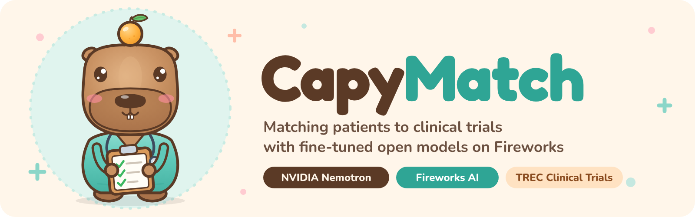
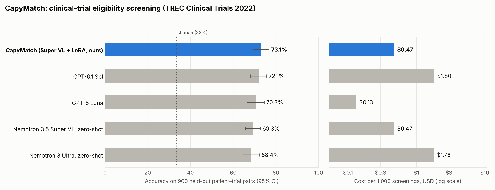

<p align="center"></p>

# CapyMatch

**Clinical-trial pre-screening with a fine-tuned NVIDIA Nemotron on Fireworks.**
CapyMatch reads a patient note and a ClinicalTrials.gov record and says whether the patient is
**eligible**, **excluded**, or **not relevant**, the way a research coordinator pre-screens charts.
We fine-tuned NVIDIA Nemotron 3.5 Super VL with LoRA on Fireworks serverless training and compared it with
OpenAI's flagship and low-cost models on the same held-out patients.

<!-- RESULTS -->
## Results

On **900 held-out patient–trial pairs from 50 patients the model never saw** (TREC Clinical Trials 2022):

- **Frontier-level accuracy at about a quarter of the frontier's price.** CapyMatch scores **73.1%** vs
  **72.1%** for GPT-6.1 Sol (difference +1.0 pts, 95% CI -2.1 to +4.2;
  McNemar p = 0.53, a statistical tie) at **$0.47 vs $1.80 per 1,000 screenings (3.8× cheaper)**.
- **Fine-tuning is what gets it there:** +3.8 pts over the same Nemotron model zero-shot (95% CI +1.6 to +5.9, p = 0.010)
  and +4.7 pts over Nemotron 3 Ultra zero-shot (p = 0.002).
- **Finds the most eligible patients:** 78% recall on `eligible` (GPT-6.1 Sol 72%, GPT-6 Luna 69%),
  at lower precision (72% vs 79%). That is the right tradeoff for pre-screening, where a coordinator confirms every flagged match.
- **Knows when it is sure:** on the 70% of pairs where it is most confident, CapyMatch is **82.9%** accurate
  (50%: 87.1%), so a site can auto-screen the bulk and send the rest to a person.

<p align="center"></p>

| System | Type | Accuracy (95% CI) | Macro-F1 (95% CI) | Eligible P / R | $ per 1k screens | p50 latency |
|---|---|---|---|---|---|---|
| **CapyMatch (Super VL + LoRA, ours)** | open + fine-tuned on Fireworks | **73.1%** (69.3–76.8) | 72.8 (68.8–76.5) | 72% / 78% | $0.47 | 3.7s |
| GPT-6.1 Sol | closed frontier (OpenAI) | 72.1% (68.1–75.6) | 71.7 (67.7–75.2) | 79% / 72% | $1.80 | 1.4s |
| GPT-6 Luna | closed, low-cost tier (OpenAI) | 70.8% (66.5–74.5) | 70.3 (65.8–74.1) | 82% / 69% | $0.13 | 1.6s |
| Nemotron 3.5 Super VL, zero-shot | open, Fireworks serverless sampling | 69.3% (65.7–72.7) | 69.5 (65.8–72.9) | 83% / 58% | $0.47 | 0.9s |
| Nemotron 3 Ultra, zero-shot | open, Fireworks serverless | 68.4% (64.5–72.2) | 67.7 (63.6–71.5) | 81% / 65% | $1.78 | 4.0s |

| Ours vs | Accuracy Δ (95% CI) | Macro-F1 Δ (95% CI) | McNemar p | Cost ratio (baseline ÷ ours) |
|---|---|---|---|---|
| GPT-6.1 Sol | +1.0 pts (-2.1 to +4.2) | +1.0 (-2.2 to +4.4) | 0.53 | 3.8× |
| GPT-6 Luna | +2.3 pts (-0.3 to +5.2) | +2.5 (-0.3 to +5.6) | 0.11 | 0.3× |
| Nemotron 3 Ultra, zero-shot | +4.7 pts (+1.7 to +7.8) | +5.1 (+2.0 to +8.4) | 0.0019 | 3.8× |
| Nemotron 3.5 Super VL, zero-shot | +3.8 pts (+1.6 to +5.9) | +3.3 (+0.8 to +5.5) | 0.0098 | 1.0× |

**Selective screening** (CapyMatch auto-screens confident pairs; the rest go to GPT-6.1 Sol):

| Auto-screened share | CapyMatch accuracy on auto-screened | Overall accuracy with escalation | $ per 1k screens |
|---|---|---|---|
| 100% | 73.1% | 73.1% | $0.47 |
| 90% | 76.4% | 73.1% | $0.65 |
| 80% | 79.4% | 73.3% | $0.83 |
| 70% | 82.9% | 73.2% | $1.01 |
| 60% | 85.0% | 72.6% | $1.19 |
| 50% | 87.1% | 72.1% | $1.37 |

With the confidence threshold fixed on dev (keep 80% of dev pairs): 71% of test pairs auto-screened at 82.6% accuracy; overall 73.3% (95% CI 69.4–76.7), +1.2 pts vs GPT-6.1 Sol alone (95% CI -0.3 to +2.9, McNemar p=0.15) at $0.99 per 1k screens.

**Tradeoffs we measured:**
- GPT-6 Luna (OpenAI's low-cost tier) is cheaper per screening ($0.13) and 2.3 pts less accurate,
  a difference that is not statistically significant (p = 0.11).
- Latency: the fine-tuned model was sampled through Fireworks' shared *training* pool (p50 3.7s). A dedicated deployment
  merges the LoRA into the base weights and serves at base-model speed (the base model's p50 was 0.9s on the same pool).
- Escalating CapyMatch's least-confident pairs to GPT-6.1 Sol barely moves overall accuracy (73.3% with the dev-fixed threshold),
  because Sol struggles on the same hard pairs. Confidence is better used to route work to a human reviewer.

## Project overview

| | |
|---|---|
| **Task** | Patient–trial eligibility: given a patient description and a trial record, label the pair `eligible`, `excluded`, or `not_relevant` (TREC Clinical Trials definitions). |
| **Intended user** | Research coordinators at hospitals, trial sites, and CROs who pre-screen patient charts against long eligibility lists; patient-matching services. |
| **Why it matters** | Most clinical trials miss their enrollment targets, and screening is manual: every patient has to be checked against hundreds of trials, each with dozens of criteria. A screener that is accurate *and* cheap enough to run on every patient–trial pair changes what is feasible. |
| **Approach** | LoRA SFT of **NVIDIA Nemotron 3.5 Super VL (120B MoE, 12B active)** on 3,000 expert-judged patient–trial pairs, trained and sampled on **Fireworks serverless training**. **Nemotron 3 Ultra** on Fireworks serverless writes a one-line, criterion-citing explanation for the coordinator. |

## How it works

```
patient note ─┐
              ├─► CapyMatch screener ─────────────► eligible / excluded / not_relevant
trial record ─┘   Nemotron 3.5 Super VL + LoRA          │
                  (Fireworks serverless training)       ▼
                                              Nemotron 3 Ultra (Fireworks serverless)
                                              "Excluded: trial requires age ≤ 24; patient is 34."
```

- **Prompt:** every system, ours and baselines, gets the identical system prompt and input (`capymatch/prompts.py`).
- **Fine-tuning:** 2 epochs, LoRA rank 16, batch 32, peak LR 1e-4 with cosine decay. Loss only on the answer tokens.
  The prompt is rendered with the model's official chat template with thinking disabled (`capymatch/nemotron.py`).
- **Checkpoint choice:** made on a dev split of 5 held-out 2021 patients, never on test.

## Evaluation method

- **Data:** [TREC Clinical Trials](https://www.trec-cds.org/) 2021 and 2022. Synthetic patient descriptions written by
  clinicians, real ClinicalTrials.gov records (2021-04-27 snapshot), and expert relevance judgments
  (2 = eligible, 1 = excluded, 0 = not relevant).
- **Splits (no patient overlap):**
  - train: 3,000 pairs from 70 TREC 2021 patients
  - dev: 120 pairs from 5 other 2021 patients
  - **test: 900 pairs from all 50 TREC 2022 patients**, label-balanced (300 per class), spread round-robin across patients
- **Metrics:** accuracy, macro-F1, and precision/recall on `eligible`; cost per 1,000 screenings at list price from
  measured tokens; client-side latency.
- **Uncertainty:** 95% confidence intervals from a **patient-clustered bootstrap** (2,000 draws over the 50 test
  patients, since pairs from one patient are correlated). Paired differences use the same draws.
  **Exact McNemar tests** on per-pair correctness.
- **Baselines:** **GPT-6.1 Sol** (OpenAI's flagship), **GPT-6 Luna** (OpenAI's low-cost tier), **Nemotron 3 Ultra**
  zero-shot (Fireworks serverless), and **Nemotron 3.5 Super VL** zero-shot (the same model before fine-tuning).
  OpenAI models run with their default reasoning settings.

## Reproduce

```bash
git clone <this repo> && cd hack-fireworks
cp .env.example .env              # add FIREWORKS_API_KEY, OPENAI_API_KEY (ELEVENLABS_API_KEY only for the video)
make setup                        # venv + CPU torch + fireworks-ai[training]
make data                         # TREC topics/judgments + ClinicalTrials.gov snapshot (~1.8 GB), builds data/*.jsonl
make baselines                    # GPT-6.1 Sol, GPT-6 Luna, Nemotron 3 Ultra, Super VL zero-shot
make finetune                     # LoRA SFT on Fireworks serverless training (~15 min)
make eval-tuned evaluate          # dev checkpoint choice, test predictions, metrics, CIs, chart
make demo                         # demo/examples.json from real predictions; open demo/index.html
```

All predictions are committed in `results/preds/`, so `make evaluate` reproduces every number above without any API calls.

### Screen a patient against live trials

```bash
.venv/bin/python -m capymatch.screen --patient-file note.txt --nct NCT03898388 NCT01031576
```

```
NCT03898388  eligible      Correlating the OA Knee Microenvironment to Outcomes After Regenexx-SD
    why: Meets inclusion criteria 3 and 4 (OA pain, swelling, functional disability, and exam findings) and age 35-85; no exclusion criteria met.
NCT01031576  excluded      Postural Analysis in Patients With Knee Osteoarthritis
    why: Patient is 47, below the trial's minimum age of 60.
```

The CLI pulls each record from the ClinicalTrials.gov API, renders it the same way as the training data, labels it
with the fine-tuned checkpoint (Fireworks serverless sampling), and asks Nemotron 3 Ultra for the one-line reason.
The fine-tuned LoRA is also promoted to a deployable Fireworks model (`capymatch-nemotron-e1`) for dedicated serving.

## Repository layout

| Path | What |
|---|---|
| `capymatch/data.py` | builds train/dev/test pairs from TREC + ClinicalTrials.gov |
| `capymatch/prompts.py` | shared prompt and label parser |
| `capymatch/run_chat.py` | OpenAI / Fireworks chat-completions runner (resumable, logs tokens and latency) |
| `capymatch/finetune.py`, `capymatch/nemotron.py` | LoRA SFT on Fireworks serverless training |
| `capymatch/run_sampler.py` | scores base and fine-tuned checkpoints through serverless sampling |
| `capymatch/evaluate.py` | metrics, clustered bootstrap CIs, McNemar, cost, chart |
| `capymatch/explain.py` | Nemotron 3 Ultra explanations for coordinators |
| `demo/` | static demo page (`index.html` + `examples.json`) |
| `video/` | narrated demo video pipeline (HTML scenes, ElevenLabs narration, ffmpeg) |
| `assets/` | the CapyMatch capybara (original SVG art) |

## Limitations

- **Labels are expert judgments with known noise.** TREC assessors' "excluded" vs. "not relevant" calls are not
  always crisp, and a fine-tuned model partly learns those conventions. That is useful for matching TREC, but
  it is not the same as clinical ground truth.
- **Synthetic patient notes.** TREC topics are written by clinicians, not taken from real EHRs. Real charts are longer and messier.
- **Balanced test set.** Real screening is dominated by `not_relevant` pairs. We report eligible precision and recall
  so the screening tradeoff is visible.
- **Serving cost.** The tuned LoRA is priced at Fireworks' serverless-training sampling rate, which includes a
  limited-time 50% discount. Production serving would use a dedicated deployment billed per GPU-hour, so cost per
  screening then depends on utilization.
- **Decision support, not diagnosis.** CapyMatch flags candidates for a human coordinator; it does not decide enrollment.

## Credits

Data: TREC Clinical Trials 2021/2022 (NIST) and ClinicalTrials.gov (U.S. National Library of Medicine).
Models: NVIDIA Nemotron 3.5 Super VL and Nemotron 3 Ultra served and fine-tuned on Fireworks AI, and OpenAI GPT-6.1 Sol and GPT-6 Luna as baselines.
Mascot and banner: original artwork made for this project.
